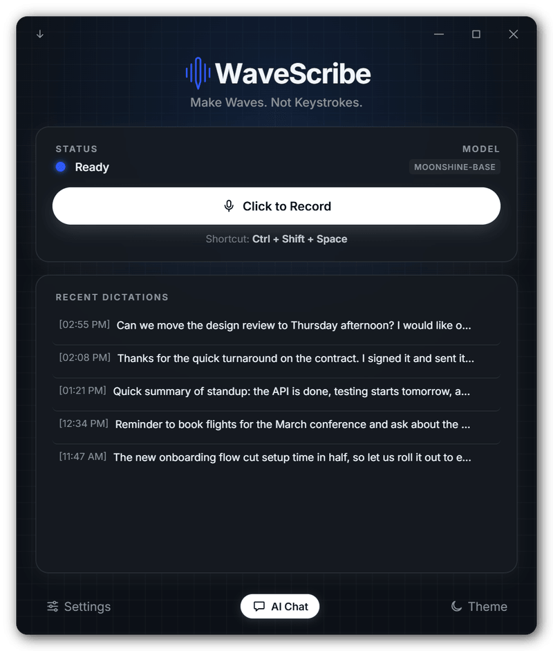
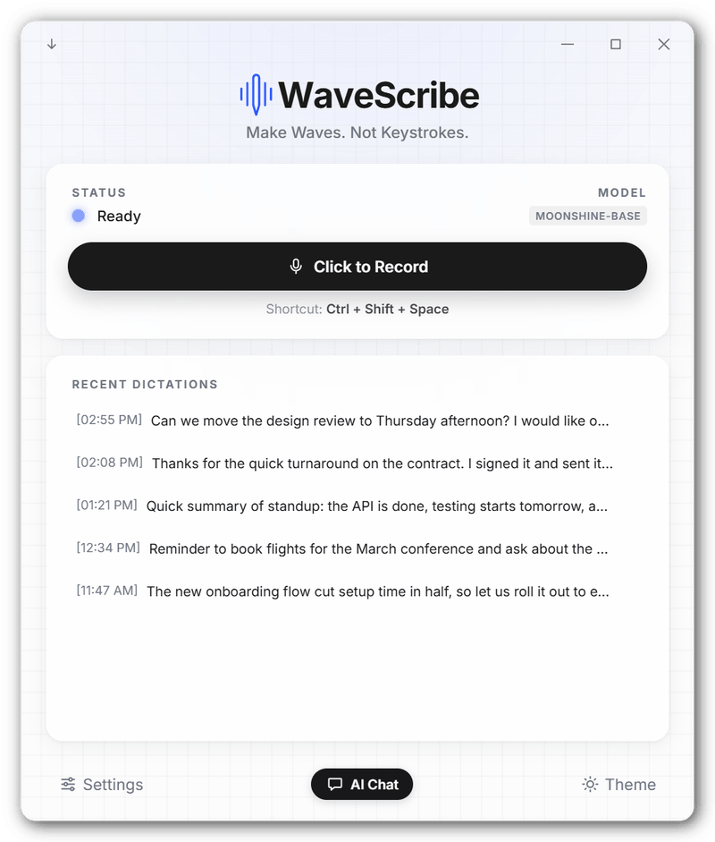
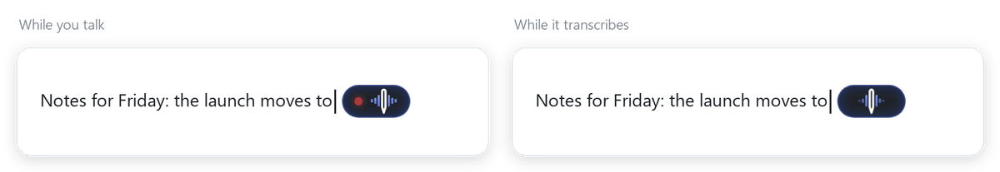
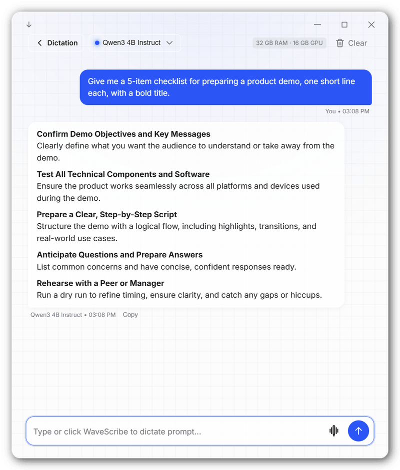
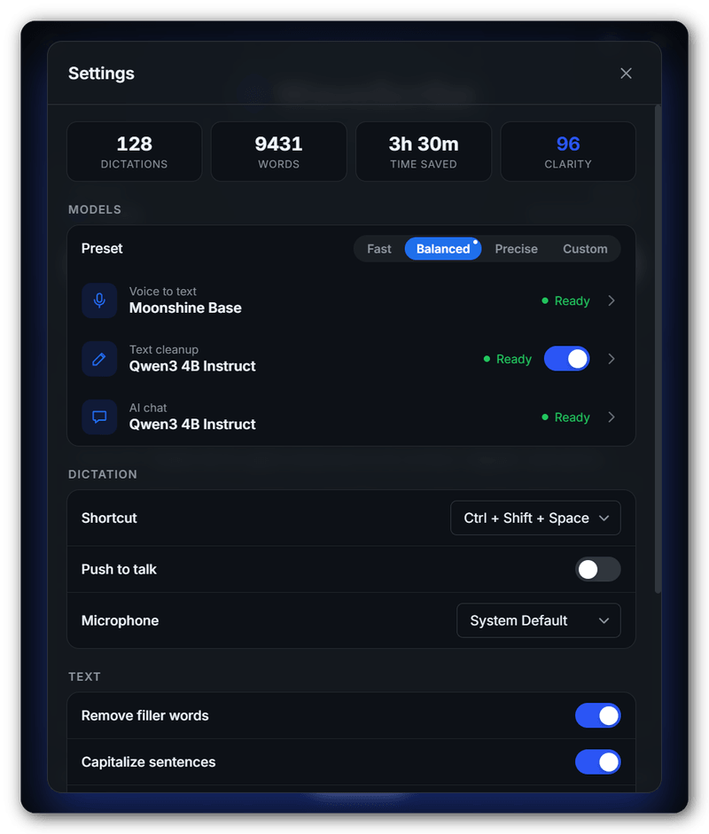
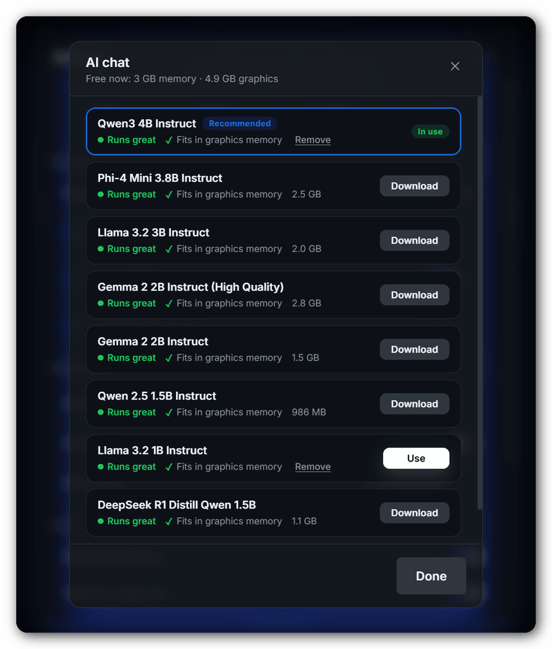
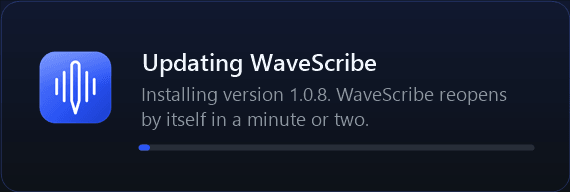

<p align="center">
  
</p>

<h1 align="center">WaveScribe</h1>

<p align="center">
  <b>Make Waves. Not Keystrokes.</b><br>
  Private voice dictation for Windows that types wherever you are. Everything runs on your own PC.
</p>

<p align="center">
  <a href="https://github.com/ethangale25/WaveScribe/releases/latest"></a>
  
  
</p>

<p align="center">
  
  
</p>

---

## Why WaveScribe

- **Private.** Speech recognition and the AI features run on your PC. Your voice and your text never leave it.
- **Works everywhere.** Press the shortcut in any app (email, Word, Slack, a browser, your code editor) and the text lands where your cursor is.
- **Fast.** Speech is transcribed while you talk, so the text appears moments after you stop.
- **Made for your PC.** WaveScribe looks at your hardware and the memory that is free right now, and recommends models that will run well on it.
- **Free and open source** under the MIT license.

## How it works

1. Click into any text field and press **Ctrl + Shift + Space**.
2. Talk. A small WaveScribe indicator appears next to your text cursor, moving with your voice.
3. Press the shortcut again. Your words appear right where you were typing, punctuated and cleaned up.

<p align="center">
  
</p>

Prefer to hold a key while you speak? Turn on **Push to talk** in Settings.

## Features

### Dictation
- **Live transcription** phrase by phrase while you speak, with a live preview of the words so far.
- **Clean text:** filler words (um, uh) removed, sentences capitalized and punctuated.
- **Custom words** to fix names and terms it mishears (for example "gooey" → "GUI").
- **Optional AI cleanup:** a local language model polishes punctuation without rewriting what you said. Or choose **Smart edit**: it also drops self-corrections ("Tuesday, no wait, Wednesday") and false starts, turns spoken lists into lists, and understands "new paragraph" and "scratch that".
- **Voice commands:** select text in any app, press **Ctrl + Alt + Space** and say what to change ("make this more formal", "turn this into bullet points", "translate to Spanish"). The selection is replaced with the result. With nothing selected, it writes what you ask for.
- **Mini mode:** shrink WaveScribe to a small pill that floats above your work and shows when it is listening.
- **History and stats:** your last dictations, words dictated and time saved.

<p align="center">
  
</p>

### AI chat
Chat with open-source models such as Llama, Qwen, Gemma and Phi, running entirely on your PC. Replies are formatted (headings, lists, code), and you can dictate your questions too.

<p align="center">
  
</p>

### Models that fit your PC
Choose three models independently in Settings: **Voice to text**, **Text cleanup** and **AI chat**. Or pick a **Fast**, **Balanced** or **Precise** preset in one click. Every model shows whether it runs well with the memory free right now and whether it fits on your graphics card, and the best one for the job is marked **Recommended**.

<p align="center">
  
  
</p>

### Updates without the hassle
WaveScribe checks for new versions on its own and downloads them in the background. When one is ready, an **Update to vX** button appears at the top of the window. One click installs it, and WaveScribe reopens by itself a minute later.

<p align="center">
  
</p>

## Download and install

1. Download **WaveScribe-Setup-*version*.exe** from the [latest release](https://github.com/ethangale25/WaveScribe/releases/latest).
2. Run it. Windows may show a SmartScreen notice for new apps; choose **More info → Run anyway**.
3. Open WaveScribe and press **Ctrl + Shift + Space** in any app to start dictating. The voice model downloads on first use (40–750 MB depending on the model).

**System requirements:** Windows 10 or 11 (64-bit). 8 GB of RAM is recommended; the AI features need more for larger models. A graphics card is optional: it speeds up the larger models, and WaveScribe only recommends what fits.

### What goes online
Your audio and text stay on your PC. WaveScribe connects to the internet only to download the models you choose (from Hugging Face), to check GitHub for updates, and to load its font.

## Keyboard shortcuts

| Shortcut | Action |
| --- | --- |
| `Ctrl + Shift + Space` | Start or stop dictating (change it in Settings) |
| Hold the shortcut | Push to talk, when enabled in Settings |
| `Ctrl + Alt + Space` | Voice command on the selected text (change or turn off in Settings) |
| `Enter` / `Shift + Enter` | Send a chat message / new line |

---

## For developers

### Run from source
Double-click `run.bat` (installs dependencies on first run, then starts the app), or:

```bash
npm install
npm run dev        # Vite + Electron with hot reload
npx tsc --noEmit   # type-check
npm test           # unit tests
```

### Build the installer

```bash
npm run build      # vite build + electron-builder (NSIS installer in release/)
npm run icons      # regenerate the app icon and installer artwork from scripts/make-icons.mjs
```

### Release
Bump `version` in `package.json`, commit, then push a tag. GitHub Actions builds the installer and publishes it to GitHub Releases, where installed copies pick it up:

```bash
git tag v1.1.0 && git push origin v1.1.0
```

### How dictation works
1. `src/audio.ts` captures 16 kHz mono audio and feeds `src/segmenter.ts`, which splits it into
   phrases at natural pauses. If someone talks for 6.5 s without a pause, it cuts at the quietest
   point instead of mid-word.
2. Each phrase goes to `StreamingTranscriptionSession` (`src/transcribe.ts`), which decodes one
   phrase at a time while recording continues (Moonshine and Whisper via transformers.js, on a
   multi-threaded CPU or WebGPU).
3. When you stop, only the final fragment is left to decode. `src/stitch.ts` then joins the phrases:
   at a forced cut it removes the false full stop the model added and lowercases the continuation.
4. Filler removal, custom words, capitalization and (optionally) the local LLM run, then the text is
   pasted with a native `SendInput` call (`electron/win32.ts`).

### Project layout

| Path | What it holds |
| --- | --- |
| `src/main.ts` | The window: dictation, settings, model pickers, AI chat |
| `src/transcribe.ts`, `src/audio.ts`, `src/segmenter.ts` | Speech capture and streaming transcription |
| `src/llm-fit.ts` | Which AI models run well with the memory free right now |
| `src/icons.ts` | The app's icon set |
| `electron/main.ts` | Main process: window, hotkey, tray, paste, IPC |
| `electron/llm.ts` | Local AI models (node-llama-cpp): downloads, cleanup and chat |
| `electron/caret.ts`, `electron/caret-indicator.ts` | Finding the text cursor and the indicator beside it |
| `electron/updater.ts`, `electron/update-splash.ts` | Automatic updates and the install screen |
| `tools/eval` | End-to-end measurement of latency and accuracy (see its README) |

### Tests and measuring changes
`npm test` runs the unit tests (stitcher, AI-cleanup fidelity gate, segmenter, post-processing,
model recommendations).

`tools/eval` runs synthetic speech through the real pipeline and reports stop-to-text latency and
word error rate, and can drive the whole app (fake microphone, real key presses, throw-away
profile). See `tools/eval/README.md`.

`AUDIT.md` lists known issues and the remaining roadmap. Settings and history are stored with
`electron-store` in your user profile.

## License

[MIT](LICENSE.txt) © 2026 Ethan Gale
